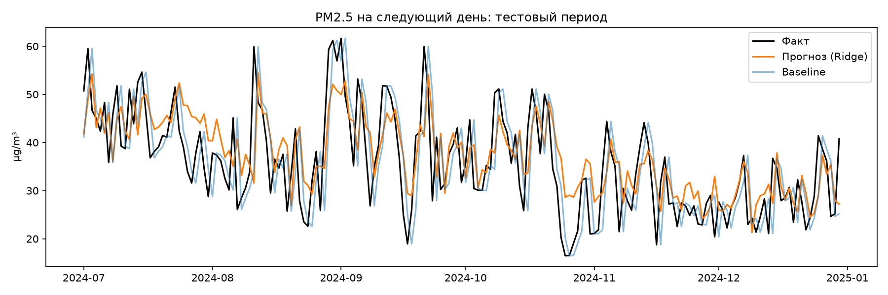
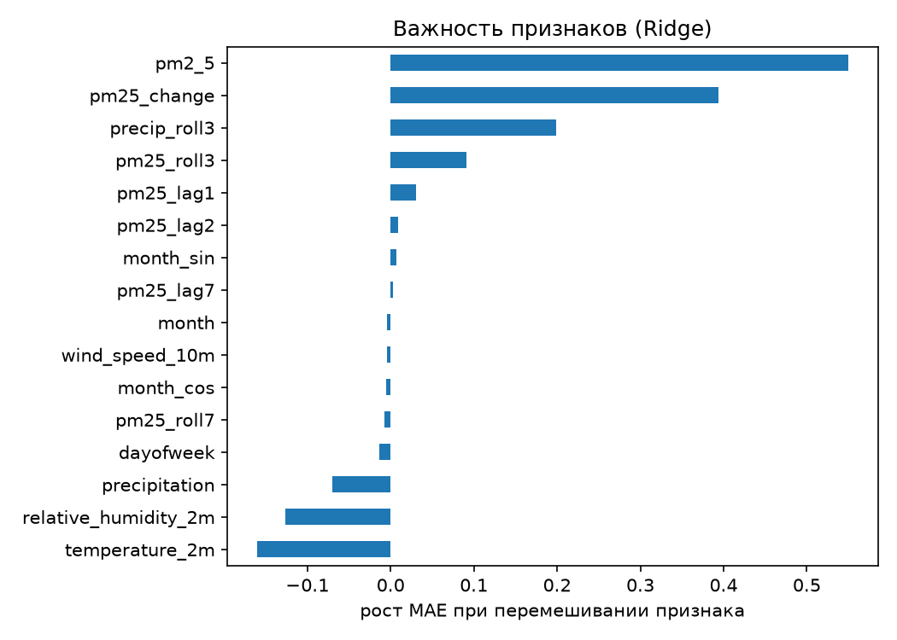

# Прогноз PM2.5 на завтра для Куала-Лумпура

Проект прогнозирует среднесуточную концентрацию PM2.5 (µg/m³) на следующий день по данным о качестве воздуха и погоде за 2023-2024 годы. Лучшая модель (Ridge-регрессия) снижает ошибку на **4.9%** относительно простого прогноза «завтра будет как сегодня».

## Зачем это нужно
PM2.5 — мелкие частицы, опасные для здоровья. Прогноз на день вперёд помогает планировать активности на улице. Для Малайзии особенно важен сезон задымления (haze) из-за лесных пожаров в регионе.

## Данные
- Источник: [Open-Meteo](https://open-meteo.com) (Air Quality API и Historical Weather API), бесплатно и без ключа.
- Период: 2023-01-01 — 2024-12-31, почасовые данные: 17 544 строки = 731 день × 24 часа (2024 год високосный). Пропусков нет.
- Признаки: `pm2_5`, `temperature_2m`, `relative_humidity_2m`, `wind_speed_10m`, `precipitation`.
- Средний PM2.5 по часам: 39.2 µg/m³, медиана 33.3, максимум 158.3. Среднее выше медианы, значит в данных есть редкие высокие выбросы.
- Часовой пояс: `Asia/Kuala_Lumpur`. Сначала данные приходили в UTC, и пик температуры приходился на 06-08 ч вместо ~14 ч. После добавления параметра `timezone` пик температуры стал в 14:00.
- Данные о качестве воздуха в Open-Meteo — результат модели (CAMS), а не показания наземной станции. Это ограничение проекта.

## Как запустить
```bash
pip install -r requirements.txt
python download_data.py   # скачивает данные в data/
python train_model.py     # EDA, обучение, графики в figures/, метрики в results/
```

## Подход
1. **Суточная таблица:** почасовые данные агрегированы по дням (PM2.5, температура, влажность, ветер — среднее; осадки — сумма).
2. **Цель:** `target = pm2_5.shift(-1)` — PM2.5 завтра.
3. **Признаки:** PM2.5 вчера / позавчера / неделю назад, скользящие средние за 3 и 7 дней, изменение за день, погода сегодня, осадки за 3 дня, месяц (sin/cos), день недели.
4. **Разделение по времени:** обучение с 2023-01-08 по 2024-06-29 (539 дней), тест с 2024-07-01 по 2024-12-30 (183 дня). Случайное перемешивание не используется, чтобы модель не «подглядывала» в будущее.
5. **Модели:** Ridge, RandomForest, HistGradientBoosting; сравнение через `TimeSeriesSplit` на обучающей части и финальная оценка на тесте.
6. **Baseline:** «завтра будет как сегодня». Любая модель должна его побить.

## Результаты
Метрики на тестовом периоде (чем ниже MAE и RMSE, тем лучше; R² чем выше, тем лучше):

| Модель | MAE | RMSE | R² |
|---|---|---|---|
| Baseline (как сегодня) | 6.660 | 8.322 | 0.338 |
| **Ridge** | **6.333** | **7.781** | **0.421** |
| RandomForest | 6.457 | 7.942 | 0.397 |
| HistGradientBoosting | 6.971 | 8.457 | 0.316 |

Ridge снизила MAE на 4.9% (с 6.66 до 6.33 µg/m³), RMSE — на 6.5%. RandomForest лучше baseline только на 3.0%, а HistGradientBoosting оказалась хуже baseline примерно на 4.7%.





## Выводы
- **PM2.5 сильно зависит от вчерашнего уровня.** Простой прогноз «как сегодня» уже объясняет около трети дисперсии (R² = 0.34). Поэтому любые улучшения над ним получаются небольшими.
- **Лучше всех справилась самая простая модель.** Ridge обошла RandomForest и градиентный бустинг. Вероятная причина — мало данных: в обучении всего 539 дней, и сложные модели переобучаются. Заметно и расхождение между кросс-валидацией и тестом: по CV лучшей была RandomForest (MAE 7.67 против 8.56 у Ridge), а на тесте — Ridge. Различия между моделями небольшие, и при таком объёме данных их нельзя считать надёжными.
- **Связь погоды с PM2.5 (суточные значения):** температура +0.42, влажность −0.35, осадки −0.25, ветер почти не связан (−0.01). То есть воздух в среднем хуже в жаркие и сухие дни, а дождь и высокая влажность связаны с более чистым воздухом. Это корреляции, а не доказательство причинности, к тому же температура и влажность сами связаны между собой.
- **Что важно для прогноза.** По permutation importance главными оказались текущий уровень PM2.5, его изменение за день и осадки за последние 3 дня. Признаки `pm2_5`, `pm25_lag1` и `pm25_change` взаимосвязаны, поэтому вклад между ними распределяется условно, и по отдельности их сравнивать нельзя.
- **Сезон задымления.** На графике суточного PM2.5 виден максимум около 95 µg/m³ в октябре 2023 года. Это согласуется с трансграничным задымлением (haze) в регионе в тот период.

## Ограничения
- Всего два года данных и один город.
- Тестовый период (июль-декабрь 2024) короткий и спокойнее обучающего: MAE на тесте (6.3) ниже, чем на кросс-валидации (7.7-8.6), вероятно, из-за сильного сезона задымления в обучающей части. Качество на экстремальных днях не проверено.
- PM2.5 в источнике модельный, а не измеренный.
- Прогноз только на 1 день вперёд, без метеопрогноза на завтра в признаках.
- Разница между моделями небольшая, статистическая значимость не проверялась.

## Что можно улучшить
- Добавить прогноз погоды на завтра как признаки.
- Прогнозировать на 2-3 дня вперёд.
- Добавить данные других городов или реальных станций.
- Оценить качество отдельно для сезона задымления.
- Классификация «воздух плохой / нормальный» вместо регрессии.